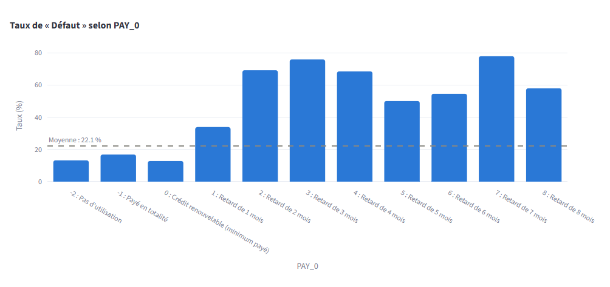
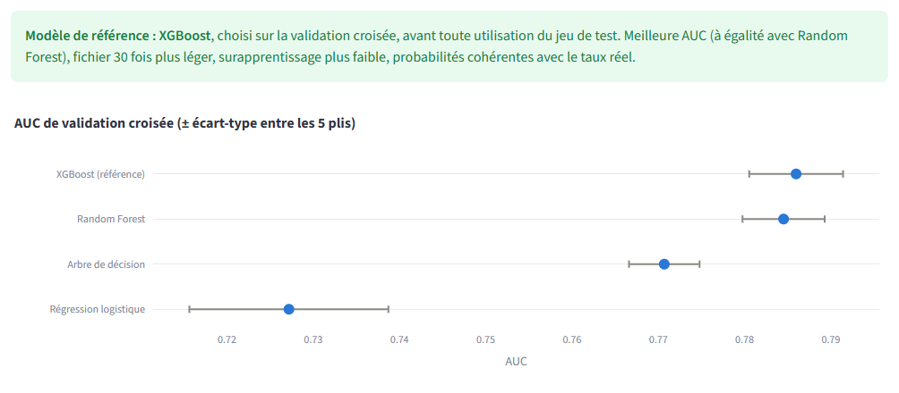
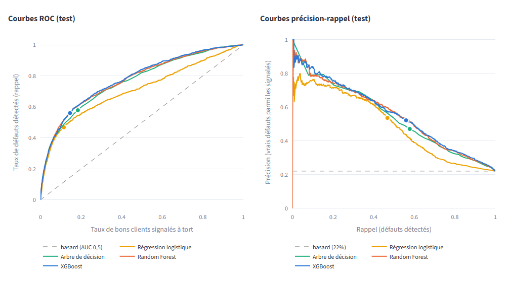
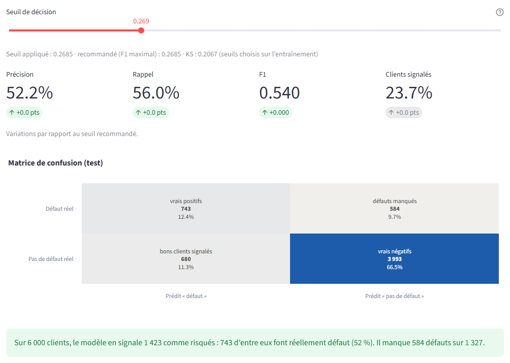
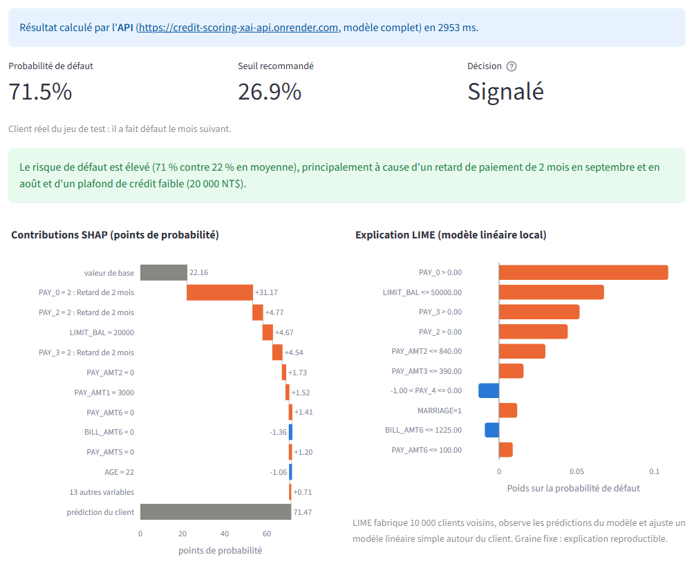
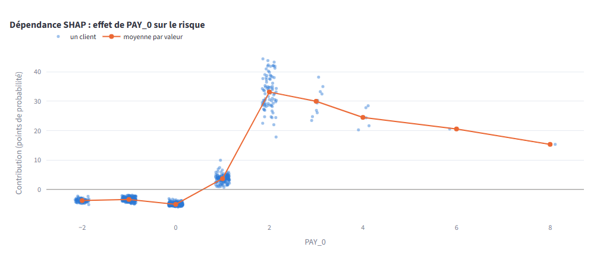
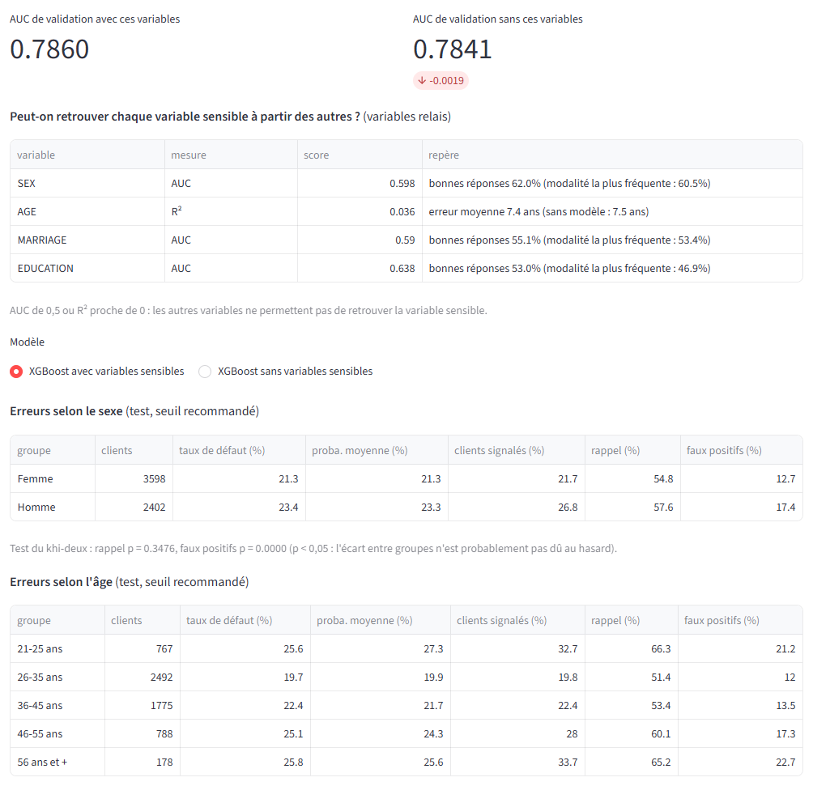
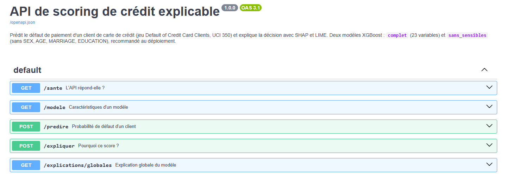

# Scoring de crédit explicable

Application web qui prédit le **défaut de paiement** d'un client de carte de crédit, compare quatre
modèles de classification et **explique leurs décisions**, pour l'ensemble des clients comme pour un
client donné (SHAP, LIME). Une API FastAPI sert le modèle et ses explications.

Projet de Data Mining, ENSI, 2026-2027 (cas métier n° 1 : scoring de crédit).

Conformément à la consigne de l'enseignante, le projet compare **2 modèles basiques** (régression
logistique, arbre de décision) et **2 modèles ensemblistes** (Random Forest, XGBoost), au lieu des
5 modèles du sujet. Tous sont réglés par **GridSearchCV**, avec le prétraitement placé dans le Pipeline
(réappris sur chaque pli de la validation croisée) : **145 combinaisons d'hyperparamètres au total**
(4, 48, 12 et 81), soit 725 entraînements sur 5 plis. Le jeu de test ne sert jamais au réglage.

## Liens

| | |
|---|---|
| Application en ligne | *lien ajouté après le déploiement* |
| API en ligne | <https://credit-scoring-xai-api.onrender.com> — documentation interactive : [`/docs`](https://credit-scoring-xai-api.onrender.com/docs) |
| Notebook d'analyse | [`notebooks/analyse_credit.ipynb`](notebooks/analyse_credit.ipynb) |
| One-pager (synthèse en une page) | [`docs/one-pager/one-pager.pdf`](docs/one-pager/one-pager.pdf) |
| Journal des choix (chaque décision, sa raison, l'alternative écartée) | [`docs/CHOIX.md`](docs/CHOIX.md) |

L'API est hébergée gratuitement : après 15 minutes sans requête, elle se met en veille et la requête
suivante peut prendre environ une minute.

## Aperçu

| | |
|---|---|
|  |  |
| **Données** : le risque est stable jusqu'au paiement du minimum, puis bondit dès un mois de retard. | **Modélisation** : quatre modèles réglés par GridSearchCV ; XGBoost retenu. |
|  |  |
| **Évaluation** : courbes ROC et précision-rappel sur le jeu de test. | **Seuil de décision** : effet sur la précision et le rappel, phrase pour le décideur. |
|  |  |
| **Explication d'un client** (par l'API) : SHAP, LIME et phrase de synthèse. | **Dépendance SHAP** : forme de l'effet du retard de paiement. |
|  |  |
| **Équité** : erreurs par sexe et par âge, modèle avec et sans variables sensibles. | **API** : les cinq endpoints documentés. |

## Résultats clés

| Modèle | AUC validation croisée | AUC test (6 000 clients) |
|---|---|---|
| **XGBoost (référence)** | 0,786 | **0,779** [0,765 ; 0,795] |
| Random Forest | 0,785 | 0,774 |
| Arbre de décision | 0,771 | 0,765 |
| Régression logistique | 0,727 | 0,710 |
| XGBoost sans variables sensibles (recommandé au déploiement) | 0,784 | 0,776 |

- XGBoost : Gini 0,558, KS 0,427, probabilités fiables (courbe de calibration proche de la diagonale).
- Au seuil recommandé (0,2685) : sur 6 000 clients du test, 1 423 sont signalés, dont 743 font
  réellement défaut ; 584 défauts sur 1 327 ne sont pas détectés.
- Modèle sans variables sensibles (SEX, AGE, MARRIAGE, EDUCATION) : seuil recommandé 0,2790.
- Variable la plus influente : le retard de paiement du dernier mois (PAY_0). Exemple, client 1358 :
  « Le risque de défaut est élevé (71 % contre 22 % en moyenne), principalement à cause d'un retard
  de paiement de 2 mois en septembre et en août et d'un plafond de crédit faible (20 000 NT$). »

L'analyse complète (calibration, comparaison SHAP / LIME, équité, compromis performance /
interprétabilité) est dans le notebook et le one-pager.

## Installation (Windows, PowerShell)

Prérequis : Python 3.11 et Git. Choisissez un dossier au chemin court : Windows limite les chemins de
fichiers à 260 caractères, et certaines bibliothèques contiennent des chemins internes longs.

```powershell
git clone https://github.com/aljene307/credit-scoring-xai.git
cd credit-scoring-xai
py -3.11 -m venv .venv
.\.venv\Scripts\python.exe -m pip install --upgrade pip
.\.venv\Scripts\python.exe -m pip install -r requirements-dev.txt
Copy-Item .env.example .env
```

- `requirements-dev.txt` installe l'application, l'API, les tests et le notebook, ainsi que le code du
  projet (paquet `credit_scoring`).
- `.env` contient l'adresse de l'API utilisée par l'application (`API_URL`) et le délai d'attente
  (`API_TIMEOUT`). Pour utiliser l'API en ligne, ouvrez-le (`notepad .env`) et indiquez :

  ```
  API_URL=https://credit-scoring-xai-api.onrender.com
  API_TIMEOUT=30
  ```

  `.env` n'est jamais commité (il figure dans `.gitignore`).

Sous Linux ou macOS : `python3.11 -m venv .venv`, puis `.venv/bin/python` à la place de
`.\.venv\Scripts\python.exe`, et `cp .env.example .env`.

## Lancer

**L'application** (puis ouvrez <http://localhost:8501>) :

```powershell
.\.venv\Scripts\python.exe -m streamlit run app\Accueil.py --server.address localhost
```

Au premier lancement, le jeu de données est téléchargé automatiquement depuis l'UCI puis gardé en cache
dans `data/`. Les modèles entraînés sont fournis dans `models/`.

**L'API en local** (documentation sur <http://127.0.0.1:8000/docs>) ; mettez alors
`API_URL=http://127.0.0.1:8000` dans `.env` :

```powershell
.\.venv\Scripts\python.exe -m uvicorn api.main:app --host 127.0.0.1 --port 8000
```

Si l'API ne répond pas, l'application calcule les explications elle-même et l'indique.

**Les tests** (environ 5 minutes) :

```powershell
.\.venv\Scripts\python.exe -m pytest
```

## Reproduire les résultats

Les fichiers de `models/` sont produits par deux scripts, avec des graines fixes :

```powershell
.\.venv\Scripts\python.exe scripts\train.py      # GridSearchCV des 4 modèles, environ 10 minutes
.\.venv\Scripts\python.exe scripts\expliquer.py  # explications globales, équité, paquet de l'API, environ 4 minutes
```

Pour réexécuter le notebook :

```powershell
.\.venv\Scripts\python.exe -m nbconvert --to notebook --execute --inplace notebooks\analyse_credit.ipynb
```

Avant de commiter le notebook, activez une fois le filtre qui retire les heures d'exécution des cellules
(réglage local, à refaire après chaque clonage) :

```powershell
git config filter.notebook-sans-horodatage.clean ".venv/Scripts/python.exe -I scripts/nettoyer_notebook.py"
git config filter.notebook-sans-horodatage.required true
```

Sous Linux ou macOS, remplacez `.venv/Scripts/python.exe` par `.venv/bin/python`.

## L'API

| Endpoint | Rôle |
|---|---|
| `GET /sante` | L'API répond-elle ? Modèles disponibles et versions |
| `GET /modele?modele=…` | Variables attendues et ignorées, seuil recommandé, AUC |
| `POST /predire` | Probabilité de défaut d'un client et décision au seuil |
| `POST /expliquer` | Contributions SHAP, règles LIME, accord entre les deux, phrase de synthèse |
| `GET /explications/globales` | Importance des variables pour l'ensemble des clients |

Deux modèles : `complet` (23 variables) et `sans_sensibles` (par défaut). Les 23 variables sont toujours
attendues ; le modèle `sans_sensibles` ignore SEX, AGE, MARRIAGE et EDUCATION et le signale dans sa
réponse. Une demande invalide (variable absente, `SEX = 7`…) est refusée avec le code 422. Le plus
simple pour essayer : la page [`/docs`](https://credit-scoring-xai-api.onrender.com/docs), bouton
« Try it out », avec les exemples proposés.

## Déploiement

- **API** : service web gratuit de [Render](https://render.com), Python 3.11.9, commande de
  construction `pip install -r api/requirements.txt`, commande de démarrage
  `uvicorn api.main:app --host 0.0.0.0 --port $PORT`, contrôle de santé `/sante`. Au démarrage, l'API
  lit seulement les deux modèles XGBoost et un paquet de 48 Ko (`models/demarrage_api.joblib`) : elle
  n'a pas besoin du jeu de données.
- **Application** : Streamlit Community Cloud, fichier de démarrage `app/Accueil.py`, Python 3.11,
  réglage `API_URL` dans les « Secrets » de l'application.

## Structure du dépôt

```
api/                  API FastAPI (schémas, moteur, endpoints)
app/                  Application Streamlit : Accueil.py et une page par module (views/)
docs/                 Journal des choix, captures d'écran, one-pager
models/               Modèles entraînés et explications précalculées
notebooks/            Notebook d'analyse complet, exécuté
scripts/              Entraînement, explications globales, nettoyage du notebook
src/credit_scoring/   Code partagé par l'application, l'API et le notebook
tests/                Tests automatiques (pytest)
```

## Données

**Default of Credit Card Clients** (Taïwan, 2005), UCI Machine Learning Repository, identifiant 350 :
30 000 clients, 23 variables explicatives, cible : défaut de paiement le mois suivant (22,1 % de
défauts).

- Source : <https://archive.ics.uci.edu/dataset/350/default+of+credit+card+clients>
- Licence : [CC BY 4.0](https://creativecommons.org/licenses/by/4.0/)
- Référence : Yeh, I. C., & Lien, C. H. (2009). The comparisons of data mining techniques for the
  predictive accuracy of probability of default of credit card clients. *Expert Systems with
  Applications*, 36(2), 2473-2480.
- Modifications : colonnes renommées (X1…X23 → LIMIT_BAL, SEX…) ; modalités non documentées regroupées
  (EDUCATION 0, 5, 6 → « Autres ou inconnu » ; MARRIAGE 0 → « Autres »).

Le jeu est téléchargé automatiquement et n'est pas inclus dans ce dépôt. Le fichier
`models/demarrage_api.joblib` contient deux échantillons de 500 lignes du jeu (les clients de référence
des explications de l'API, un échantillon par modèle), sous la même licence.

## Limites

- Données de Taïwan en 2005 : le comportement des clients d'aujourd'hui peut être différent.
- Le codage des retards de paiement semble varier d'un mois à l'autre (la valeur « 1 mois de retard »
  n'apparaît presque qu'en septembre).
- 795 comptes sans aucune facture ni aucun paiement font pourtant défaut à 37,6 % : possible bruit dans
  la définition du défaut.
- Le jeu ne fournit pas le coût d'un défaut non détecté ni celui d'un bon client refusé : le seuil est
  choisi sur le F1, pas sur un coût réel.
- Les explications LIME varient pour une partie des clients d'un tirage à l'autre ; SHAP sert de
  référence.

Détails et autres limites : [`docs/CHOIX.md`](docs/CHOIX.md).

## Licence

Code sous licence MIT, voir [LICENSE](LICENSE). Le jeu de données reste sous sa propre licence
CC BY 4.0.

Auteur : Mohamed Aljene, ENSI.
